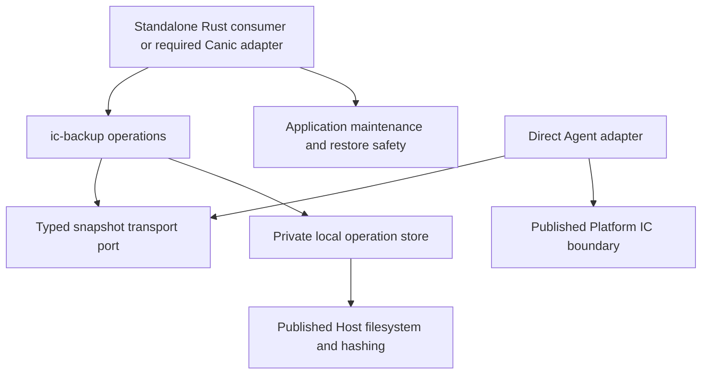

# IC Backup library design

Status: design proposal, 2026-11-14. The user selected **single-canister library
first**: back up one already-stopped canister and restore to the same existing
ID. Capture/restore APIs, records and limits below remain proposed. The narrow
[local inventory contract](../architecture/local-inventory.md) records implemented behavior.
The [operation contract](operation-contract.md) refines consumer, transport,
metadata comparison and transfer-budget semantics; it takes precedence over the
broad sketches below for those details. The [restart direction](restart.md) owns
the restart context; the [current handoff](../status/current.md) owns
implementation status. The [local-store contract](local-store.md) owns the
selected layout, inventory semantics, completion publication and target exclusion.

The first usable outcome is a Rust consumer that captures a stopped canister,
retains a verified local recovery bundle, and later uploads and loads that bundle
into the same stopped canister. The consumer can inspect interrupted work without
network activity and continue only where its original authority permits it.
Canic is a required consumer of this contract, alongside standalone use. The
[sibling integration design](sibling-integration.md) specifies its actual signer,
controller topology, supplier dependencies and remaining integration gaps.

## 1. What the legacy project teaches us

The [legacy assessment](legacy-assessment.md) records the explicit keep, adapt
and leave-behind decisions, with source evidence and recovery tradeoffs.

Inspected GitHub source: `dragginzgame/ic-backup-legacy` at
`4ae087fad8c23de712aa60bf569bde4b2b932651`. Its handoff records library release
0.67.2 at `9cebbc1e52dd93fb3509a65fb551cb2df1ba99a4`. These are different
identities: the later documentation commit is not another product release.
Legacy handoff statements about local paths and a then-current branch head are
historical observations, not the present checkout inventory.

| Evidence | Design consequence |
| --- | --- |
| [Implemented contracts](https://github.com/dragginzgame/ic-backup-legacy/blob/4ae087fad8c23de712aa60bf569bde4b2b932651/docs/architecture/implementation-contracts.md) bind exact plans, spending, artifacts and recovery evidence. | Preserve those safety properties; derive new mechanisms for the narrower scope. |
| [Standalone assembly](https://github.com/dragginzgame/ic-backup-legacy/blob/4ae087fad8c23de712aa60bf569bde4b2b932651/crates/ic-backup-agent/src/standalone/README.md) already composes a single-canister round trip with mandatory application callbacks. | Do not describe legacy as having no complete flow at all. The missing general product experience and installed integrations are distinct from its qualified fixture assembly. |
| That assembly fixes each transfer stage at eight data requests and freezes capture and restore catalogues before capture. | Select finite transfer limits explicitly, and create an independently reviewed restore operation when recovery is needed. |
| [Reservation measurement](https://github.com/dragginzgame/ic-backup-legacy/blob/4ae087fad8c23de712aa60bf569bde4b2b932651/docs/audits/mega/07/report.md) observes quadratic peer-journal reads under the legacy admission contract. | Propose one authoritative ledger per operation with exclusive ownership, rather than caching independently mutable peer journals. This changes the storage contract and needs new qualification. |
| [IC qualification](https://github.com/dragginzgame/ic-backup-legacy/blob/4ae087fad8c23de712aa60bf569bde4b2b932651/docs/qualification/pocketic-qualification.md) distinguishes real ingress, process failures, fixture safety and application acceptance. | Reuse the kinds of proof. Rerun independently authored tests against the new product; historical results are not new qualification. |
| [Record/API boundary](https://github.com/dragginzgame/ic-backup-legacy/blob/4ae087fad8c23de712aa60bf569bde4b2b932651/docs/architecture/extraction-boundary.md) explicitly preserves retired layouts and obligations. | Never reinterpret legacy bundles or unfinished journals through the restart. |

The [original extraction design](https://github.com/dragginzgame/ic-backup-legacy/blob/4ae087fad8c23de712aa60bf569bde4b2b932651/docs/design/extraction-design.md)
remains useful rationale. Its proposed CLI, partial-transfer resume and application
flows are not evidence that those features were delivered.

## 2. Product scope and meaning of success

| Operation | First-version guarantee |
| --- | --- |
| Capture | One exact stopped canister, authenticated snapshot creation and complete download, verified durable bundle, canister left stopped. |
| List / latest | Read local completion manifests and select the latest captured completed bundle per network/canister; report verification-at-capture separately from fresh integrity. |
| Verify | Bounded local inspection and fresh hashing of the complete bundle, with no network calls. Integrity is distinct from provenance and application safety. |
| Restore | Verified original bundle, same network/release/canister ID, complete upload and authenticated load, final observed stopped state. |
| Inspect | Local state, consumed allowances, unresolved calls and retained evidence. No probes, repairs or effects. |
| Continue | Reopen original work, validate its evidence and execute only unconsumed steps after settled predecessors. |
| Reconcile | Explicit, separately budgeted observations of an original pending request; persist evidence or report unresolved uncertainty. |

A capture receipt means `BackupVerified`. A restore receipt means `LoadedStopped`:
that the selected snapshot load settled and the canister was subsequently observed
stopped under the operation's maintenance custody. It does **not** mean
`ApplicationRecovered`, authorization to start, or indefinite assurance about the
canister after custody ends. An integration owns application acceptance and restart.
If verification requires running application code, the integration must define a
separate fenced execution procedure; this library never starts the canister for it.

The first version excludes automatic stop/start, multi-canister consistency,
canister allocation/deletion, controller changes, automatic funding, snapshot
replacement/deletion, pruning, scheduling, remote stores, compression, encryption,
CLI and cross-release/cross-ID recovery. Keep remote snapshots and local evidence
on success and failure. Capacity exhaustion is a refusal, not permission to delete.
Independent operations may run concurrently for distinct targets; Canic owns
the finite task pool and any fleet consistency protocol. Local manifest listing
needs no database or index service. Blob Storage integration is explicitly v2.
A useful library ships before any CLI or application framework adapter.

## 3. Responsibility boundaries

Arrows express ownership/dependency direction, not runtime call direction. The
Agent adapter implements the Core-owned port; Core never depends on that adapter. Canic's host adapter may implement the same
port through an explicitly bound controller-canister executor; that route needs
its own qualified receipt and spending contract, described in the sibling review.

| Owner | Responsibility |
| --- | --- |
| Core model/policy | Exact identities, deterministic plans, limits, state transitions, transfer coverage and receipt admission. No IO in policy. |
| Core ops/workflow | Local custody, ledger durability, artifact verification, ordered execution and recovery. Workflow uses model transitions rather than mutating records. |
| Transport implementation | Signer and trust configuration, exact request preparation, one submission, authenticated response association and separately bounded status observation. |
| Application integration | Release meaning, selection/membership, maintenance custody across controllers, quiescence, external-obligation safety and permission for destructive load. |
| Host/Platform | Generic filesystem/hash mechanics and published IC identity/management codec/SDK boundaries respectively. |

Start implementation in the existing `ic-backup` package. Add the Agent package
only when the first real consumer needs its production transport. Add private
`qualification/` packages only with actual fixtures. No empty ports for remote
storage, clock services, arbitrary commands or generalized workflow scheduling.
No Canic types or control-plane dependencies enter production Core.

## 4. Proposed public contract

Expose operations and opaque validated handles, not the internal journal engine.
Names below are API sketches; final Rust signatures follow an executable independent
consumer and cancellation tests. DTOs are passive, persisted types end in `Record`,
and requests have no permissive `Default`.

| Entry point | Inputs and result |
| --- | --- |
| `plan_capture` | Exact network/trust binding, caller, canister, release binding and explicit limits; returns an immutable plan and digest without IO. |
| `plan_restore` | Verified source identity plus exact same-ID/network/release target and limits; returns a separate immutable destructive-effect plan. |
| `create_capture` / `create_restore` | Vacant private operation location, reviewed plan digest and required custody inputs; durably records original intent. Occupied or partial work refuses. |
| `advance` | Open operation, typed transport, application admission and finite work limit; returns progress, a terminal receipt, or a typed attention state. |
| `inspect` / `open` | Bounded local replay of existing original records; never invokes providers. |
| `reconcile` | Exact unresolved request identity and unused original observation allowance; returns retained evidence and a qualified settlement or unresolved state. |
| `verify_bundle` | Private bundle location and expected source identity; returns a freshly verified handle scoped to held byte custody. |

`advance` pauses only between durable steps. Its work limit does not increase any
network, byte or spending budget. A pending request blocks dependent work.
Terminal `advance` is effect-free local replay; new live checks require an explicit
operation. An async caller supplies its runtime; Core does not spawn background
work or require a process-global executor.

Use typed errors such as `IdentityMismatch`, `AuthorityUnavailable`,
`UnsupportedSnapshot`, `LimitExceeded`, `OperationOccupied`, `EvidenceChanged`,
`SourceChanged`, `UncertainEffect` and `PersistenceFailure`. Retain original typed
causes and bounded reply evidence on failures after submission. Error strings are
never recovery instructions. Progress identifies durable phase and pending request;
it never estimates completion from remote call counts alone.

## 5. Authority and trust

The direct-host profile is the first route proposed for implementation. Its
authority checks below require the actual host signer to control the target.
The required Canic executor route adds actual management-sender and executor
generation bindings; it does not weaken direct-host authority or reuse its
receipt assumptions. Both routes are unimplemented.

A plan binds canonical network identity, provisioned trust root, actual caller,
exact target, release binding, operation purpose, source when present, limits and
format identity. Normalize principals and hashes at their owning boundary. A URL
is routing information, not network identity; a reset local network requires a new
instance binding. Credentials are runtime inputs and never persisted in records.

The transport owns certificate verification and original-request attribution.
Applications should not have to reimplement IC authentication merely to call this
library. The selected backend must demonstrate that its authenticated outcome
binds the exact retained request ID, target and method. Passive decoded bytes are
not a successful receipt. Mainnet trust cannot be discovered from an arbitrary
endpoint; provision trust out of band and bind it before planning.

Application admission remains required. For this profile it supplies maintenance
custody and release meaning; restore additionally requires explicit safety to
rewind application state. Neither a Boolean `safe` flag nor an editable JSON claim
establishes that safety. A trusted in-process provider supplies bounded evidence
bound to operation, source, target and applicable fence/obligation revisions.
The library checks bindings, while the provider qualifies their real meaning.

Fresh authenticated observations establish stopped state, direct caller control,
read authority and relevant module identity. They are themselves accounted calls.
The [management specification](https://docs.internetcomputer.org/references/ic-interface-spec/management-canister/)
distinguishes snapshot visibility from controller authority; the implementation
must preserve that distinction. Reading a snapshot never grants permission to load.

Local locks coordinate cooperating host processes only. Admission must establish
maintenance custody against other authorized controllers changing code, lifecycle
or snapshots during the operation. Repeated matching status checks cannot prove
continuity between them. A single-canister profile makes no distributed consistency
claim and no claim that stopped code has no external obligations.

For the standalone same-release profile, bind exact module hash and an explicit
release identity. Refuse a missing or different current module before restore.
Recovery after uninstall/upgrade, broader release semantics and authority via a
proxy are separate designs. Preserve global/timer/hook data without treating it as
proof that resuming application execution is safe.

## 6. Capture and restore workflows

Capture follows one fixed sequence:

1. Persist the plan, operation identity and finite allowances under exclusive custody.
2. Admit fresh network/caller/release, stopped state, read/control authority,
   maintenance custody and available snapshot capacity. Refuse unsupported inputs.
3. Persist exact take intent and signed request evidence; submit once without
   replacement. Authenticate and retain the reply before marking capture settled.
4. Read and retain exact snapshot metadata. Derive the transfer schedule with checked
   arithmetic and admit exact region sizes plus conservative whole-chunk bounds
   and total call requirements before data reads.
5. Stream each exact range/chunk, retain its authenticated evidence, verify lengths,
   coverage and known chunk hashes, and durably settle it before the next step.
6. Rehash the complete closed artifact tree and recheck metadata/source bindings.
   Retain the final `PublishReady` ledger transition and publish its manifest
   create-only with file and directory durability. That manifest is the
   `BackupVerified` receipt; retain the original snapshot ID and operation evidence.

Unknown snapshot size cannot be made exact before capture. The reviewed plan
therefore authorizes one capture followed by a finite metadata-derived transfer
within fixed ceilings. An oversized result leaves the snapshot and original
journal retained; it does not enlarge the plan or silently create a second capture.

Restore is created later, under its own explicit authority:

1. Freshly verify a complete bundle and acquire stable source custody. Create a
   durable source reference before publishing a recoverable restore operation.
2. Bind the source digest, original network/ID/release, target, effect order and all
   upload/observation limits in a reviewed restore plan. Admission rechecks current
   stopped state, control, release and application permission to rewind state.
3. Allocate a new destination snapshot without replacement, retaining the exact
   authenticated allocation reply and destination ID. Upload only original bytes.
4. Settle every metadata/data request and independently verify complete destination
   metadata and bytes through bounded readback before allowing load. Compare all
   regions and chunks, not just the module hash. Account this verification up front.
5. Recheck source custody and fresh restore authority, then persist and submit one
   exact load. Authenticate its outcome and retain it. Observe the final stopped
   state under the same maintenance custody and publish `LoadedStopped`.

If a required observation, verification or custody check fails, retain the operation
and source reference. Never load another snapshot as compensation. Never start the
canister, release application fences or declare external obligations settled.
Post-load application validation remains separate even after a successful receipt.

## 7. One operation ledger and its custody

Propose a fixed sequential state machine with one append-only authoritative ledger
per capture or restore. This avoids a public DAG of stage catalogues, child plans,
peer journals and settlement checkpoints for a single canister. Fixed phases are
internal product logic; consumers do not build an execution graph. Replacing one
ever-growing JSON journal after every call would still rewrite the accumulated
history; append framing avoids that specific cost. A transactional database adds
another storage/runtime contract before this sequential workflow demonstrates a
need for it. Measure actual IO before claiming a performance improvement.

An immutable `OperationPlanRecord` anchors the operation. Bounded ledger frames
contain sequence, previous-frame digest, exact plan/operation binding and a typed
transition. Large arguments, signed envelopes, certificates and replies are separate
create-only evidence files referenced by exact length and hash. Application
configuration may be TOML; persisted machine records use a strictly specified JSON
encoding inside the framing. Encode admitted records once and commit their exact
retained bytes with distinct restart domains; never reserialize them to regenerate
intent. The local-store contract selects framing; exact record encodings and golden
vectors accompany the first writer/reader implementation.

One operation guard holds a nonblocking lifetime lock and admitted descriptors
across each await. The lock order is source bundle (restore only), operation,
then contained evidence files; never acquire another operation while holding one.
Creation also acquires the store's target claim keyed by canonical network and
canister ID. Durably bind that claim to the operation before remote effects; retain
it across process death. New work on an occupied target refuses until exact local
terminal evidence permits claim retirement. A partial/orphaned claim is attention
state, not permission to reconstruct an operation. This claim owns exclusion only;
the operation ledger remains the sole spending authority. Creation/release holds
the target-claim lock before any source or operation lock, and no held operation
acquires that lock in reverse order. Separate stores or other hosts are excluded
only by application-owned maintenance custody, never by this local claim.

All cooperating writes go through this owner. Cold reopen validates the full
bounded ledger once and rebuilds its projection. During a held session, append
validation uses that admitted prefix and checks descriptor/path/length continuity.
No per-request full scan of independently mutable peer journals is needed.

This is a new custody contract, not an equivalent optimization of legacy. Private
permissions and descriptor checks do not defeat a malicious same-user writer.
Require a private local store with no concurrent external writes; detected drift
refuses. File replacement, truncated history, hash-chain gaps, invalid transitions
or malformed tails block effectful reopen. Preserve the exact tail and expose
read-only diagnosis; never truncate it and infer unspent authority. Hashes provide
integrity checks, not signatures or rollback protection against the host owner.
Ledger compaction, concurrent writers to the same operation and automatic log
repair are deferred. This does not prevent independent target operations.

The writer syncs referenced evidence before appending its referencing transition,
and syncs the ledger before any dependent effect. Publication has its own exact
bytes/digest, rename and directory-sync recovery. A successful `write` alone is
not a durable reservation. Local completion never regenerates original timestamps,
request IDs or manifest identity.

Proposed storage groups are `operations/<id>/` for intent/ledger/evidence and
`bundles/<id>/` for verified snapshot bytes/manifest/references under one private
store. The local-store contract now specifies these groups and their ownership; its
record field encodings are not yet frozen. IDs are validated opaque
identities, never arbitrary paths supplied by remote input. Use no-follow regular
files, bounded decoding, private parents and Host's durable publication primitives.
Do not introduce a database, generic storage trait or new filesystem engine merely
for this workflow.

## 8. Uncertainty, continuation and cancellation

Each remote call, including metadata reads, has the same basic spending discipline:

| Durable state | Permitted action |
| --- | --- |
| Planned, no attempt consumed | Fresh admission, retain exact request and reserve one original attempt. |
| Reserved / possibly submitted | No automatic resubmission, even after timeout, cancellation or process death. |
| Authenticated reply retained, settlement absent | Re-admit exact original evidence and finish local settlement; no repeat call. |
| Settled success | Continue the next planned step after validating its dependencies. |
| Settled rejection | Report the original failure; retain consumed allowance. No implicit retry. |
| Unresolved | Explicit reconciliation within original observation allowance, or operator attention. |
| Terminal | Local receipt replay only. |

Persist reservation and signed ingress/request ID before submission. Each submission
is at most once by the library; this is **not** an exactly-once IC guarantee. A crash
between reservation and network IO may conservatively strand an unused attempt.
Returning ownership of a handle or finding no reply does not prove non-dispatch.

Reconciliation first tries authenticated request-status evidence for the exact
retained ingress, if supported by the selected backend. Status polling has its
own finite count, timeout and byte limits, consumed durably before each request.
It never resends or re-signs the original mutation. Unknown, expired or unavailable
status is unresolved, not evidence that the call did not execute. Qualify certificate
age, request association and retained reply recovery on the actual backend.
If that evidence cannot recover the result, first-version recovery stops for
attention; it does not infer capture/allocation from a new inventory entry, or
load from matching current bytes. More capable application-specific reconciliation
requires its own later contract.

Cold continuation may retain a verified settled transfer prefix and start the next
never-dispatched extent. It requires original authenticated receipts, exact retained
bytes and unchanged source/destination bindings. This is narrower than retrying a
partly completed network call. If bytes exist without settled evidence, preserve
them and reconcile that original call; do not append over them or count them twice.
Read-free metadata and empty chunks must have explicit coverage rules without
placeholder calls. No partial-transfer resume is claimed until these cases pass.

Cancellation stops scheduling. It never rolls back the remote world, removes
artifacts, refunds spending or starts the target. Keep source references after
failure and after `LoadedStopped`; reference retirement and pruning are deferred,
so success does not imply permission to remove recovery material.

## 9. Bundle contents, verification and bounds

A bundle binds source canister/network/release, exact snapshot metadata and raw
metadata evidence, module/heap/stable bytes, globals, certified data, optional
lifecycle metadata and chunk identities. Preserve exact bits, order, absence and
length semantics. Unknown required data refuses; absent optional data never invents
values or upload authority. The manifest declares a closed file set and exact hashes.
It is published only after full coverage and durable byte verification.

`verify_bundle` checks strict format identity, bounded fields, normalized identities,
closed paths, regular-file custody, metadata-to-file lengths and complete digests.
The operation contract owns
round-trip representability and source/destination metadata comparison; preserving
an absent external field does not authorize inventing its upload value.
Local integrity does not establish an authentic source when all files and hashes
can be replaced. A restore also needs trusted provenance from the original retained
operation or an independently trusted manifest commitment. The initial design has
no arbitrary-directory import or trust-on-first-use mode.

Required supplier choices and minimal features are specified in the
[sibling review](sibling-integration.md#dependency-selection-by-owner): Platform
for IC boundaries, Host FS/Artifacts for local custody and bytes, Testkit only
for qualification. Application storage/auth/scheduling crates remain Canic-owned
participants rather than dependencies of the host snapshot engine.

Use explicit caller-selected limits bounded by a qualified product profile. This
initial candidate profile is a **proposal for qualification**, not an IC limit:

| Resource | Proposed ceiling / rule |
| --- | --- |
| Target count / concurrent effects | Exactly one / one per operation; distinct targets may run concurrently under the caller's finite limit. |
| Individual data extent | At most 1 MiB; adapt downward to qualified backend limits. |
| Total snapshot payload | 1 GiB across all regions and chunks, checked with overflow-safe arithmetic. |
| Metadata / identifiers | 1 MiB raw metadata, 256-byte snapshot IDs, 4,096 globals, 1,024 chunk identities, retaining relevant legacy decoder bounds. |
| All original network calls | At most 8,192 per operation across preflight, transfer, verification and reconciliation; reserve separate purpose ceilings inside that total. |
| Ledger storage | At most 128 MiB; separate finite frame/event/evidence limits must be frozen with its encoding before implementation. |
| Memory and time | Bounded streaming buffers and codec work; finite per-call deadlines plus explicit finite observation counts. No whole-artifact allocation or unbounded polling. |

Before effects, reject internally inconsistent limits. After metadata, derive an
ordered transfer schedule, conservative bounds for initially unknown stored-chunk
lengths, and worst-case evidence space within the original plan, including upload readback and required final observations. Refuse before
allocation/upload if restore cannot fit. Account signing, encoded arguments, HTTP
framing and decoded allocations separately from payload size. Reuse Platform's
bounded decoder and its explicit work/allocation semantics, not a guessed equivalent
to an upstream Candid quota. Budget exhaustion retains all original work.

Call ceilings bound requests, not a fixed cycle price. Report expected costs as
estimates only, never introduce automatic funding. Disk free-space estimates do
not guarantee completion; handle ENOSPC at every durability boundary. Retained
request/reply evidence can materially exceed the artifact size. Admission must
include it, and the first implementation must measure that storage amplification.

## 10. Qualification and delivery sequence

First build the capture/verify slice as a coherent independent Rust consumer. It
must produce a real durable bundle and demonstrate crash/uncertainty behavior.
Then extend the same contract through upload/readback/load to `LoadedStopped`.
That second slice completes the selected first usable version. Neither a set of
codec helpers nor a library that delegates the entire workflow qualifies as done.

| Proof | Required evidence |
| --- | --- |
| Model and bounded inputs | Exact identities/bytes/hashes, illegal transitions, overflow, unsupported metadata, missing or excess coverage and exhausted authority. |
| Filesystem/process | Process death at intent/evidence/ledger/publication boundaries; nonblocking contention; symlink/replacement/truncation/corruption; disk-full retention; exact cold and terminal replay. |
| Transport | Correct signed-request attribution and certificate trust; bounded replies; no hidden HTTP/SDK retries; pending status and explicit bounded observation. |
| Actual IC round trip | Testkit-managed PocketIC using production transport: capture, complete download, change live state in fixture setup, upload into a new snapshot, readback, load same ID and independently compare complete state. |
| Uncertainty | Deliberately lose capture, allocation, intermediate data and load replies after real ingress; prove no repeat mutation and preserve original spending after reopen. Exercise expired/missing request status too. |
| Consumer usability | Independent normal-dependency program completes the flow without internal journal APIs, Canic or test-only product branches. |
| Supported hosts and scale | Linux and macOS persistence/transport behavior, maximum-profile streaming memory and evidence size, and ledger IO growth measured against actual workloads. |

A fixture with no external obligations qualifies only that fixture's safety.
Keep product unit tests beside their owners and Testkit/PocketIC in the separate
private qualification workspace. Retain exact original journals, requests, raw
replies, server identity/output, source artifacts and failed-case evidence.
No fake management implementation can qualify IC behavior.

Design and test the Canic consumer boundary alongside the standalone slice.
Its external signer and manager-only worker control require explicit execution
bindings; a direct-host success does not qualify the manager route. The
[sibling acceptance sequence](sibling-integration.md#implementation-order-and-acceptance)
requires Canic executor and fenced reopening qualification before claiming full
Canic support. Add multi-canister orchestration only from a concrete application
need. A later CLI calls the same operations, without a second recovery engine.

## 11. Decisions to settle before implementation

The selected product scope is settled. The [operation contract](operation-contract.md)
now specifies provider calls, execution bindings, metadata comparison, scheduling
and call-budget formulas as proposed implementation inputs. These remaining
choices need exact specifications and qualification in the first implementation:

- Exact record fields, restart hash domains and independent golden bytes for
  the selected local-store framing, plus evidence budgets and native Host fit.
- The transport's precise authenticated request-status capability and retention
  horizon; refusal behavior when a lost reply is no longer recoverable.
- The first application's concrete maintenance/restore-safety provider and its
  stopped-state acceptance boundary, without a generic bypass flag.
- The candidate 1 GiB profile, concrete per-provider encoded-size/evidence bounds
  and measured cost; raising limits is a future fresh-plan choice, never an
  interrupted-plan edit.
- Canic's external signer boundary, explicit management sender/executor binding,
  Platform's Wasm snapshot DTO availability and durable two-hop receipt protocol.
- The independent and Canic consumers' final Rust API and dependency
  selections. Choose published suppliers at implementation time, not by copying the legacy lockfile.

This design imports no legacy schemas, source or release machinery. Existing
0.67.x users keep their original qualified integration and recovery material.
The unpublished 0.100.0 library currently exposes local inventory and payload integrity checks;
publication requires a separate compatibility and consumer migration assessment.
