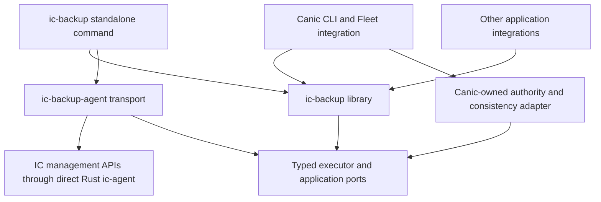

# ic-backup extraction and implementation design

Original design: 2026-10-04. This document retains the extraction rationale,
proposed complete-product behavior and acceptance criteria. Proposed CLI commands,
record names and recovery flows are not supported library contracts.

Current implementation obligations belong to [implementation contracts](implementation-contracts.md)
and exact record/API details to [the extraction boundary](extraction-boundary.md).
[Qualification](pocketic-qualification.md) describes fixture scope; the
[current handoff](status/current.md) records source-specific evidence and limits.
Read those owners before changing implemented behavior. Completing a proposal here
requires its own accepted design and qualification; it grants no new dispatch,
partial-transfer resume, terminal or application-release authority.

The [retained design at 0.37.3](https://github.com/dragginzgame/ic-backup/blob/21b0a94a1fa8241d26ed1b933e1e353fbc71d2ca/docs/extraction-design.md)
preserves the original implementation chronology and superseded descriptions.

## 1. Outcome

Move generic Internet Computer snapshot backup and recovery out of Canic into
an independent host-side library and operator tool. A non-Canic application must
be able to capture a selected canister, verify the downloaded bytes and recover
it after interruption without installing Canic or understanding Fleet journals.

Canic remains responsible for deciding which physical canisters belong to a
Fleet, proving the selected release and controllers, coordinating application
quiescence and qualifying safe framework restoration. `ic-backup` performs only
the operations authorized by that evidence and its reviewed execution plan.

The intended dependency direction is:



The arrows describe dependency ownership, not Rust trait syntax. The library
defines ports; implementations depend on those ports. The engine must not depend
on the Agent transport package, Canic adapter or downstream application libraries.

## 2. Evidence and starting conditions

Planning input is the Canic working tree on 2026-10-04, whose HEAD was
`d3b1f4ffbbbec8402f3bcef513c7a3db514f93d5`. It was dirty, including concurrent
blob extraction and unrelated repairs. Do not identify this input as an
immutable published release. [Source baseline](source-baseline.json) records
file hashes and inventory counts to detect changed extraction inputs.

Observed starting facts:

- `canic-backup` already owns a separate host-side library with dependencies on
  Candid, Serde/JSON, SHA-256, thiserror and Unix rustix; it has no direct dependency
  on another Canic crate.
- Its source comprises 131 Rust files and approximately 32,416 lines including
  tests at inspection. This is an inventory measurement, not a size-saving claim
  or a required test/source count. The recorded JSON baseline owns exact counts.
- Its public modules include artifacts, discovery, execution, journals,
  manifests, persistence, planning, restore, runners, timestamps and topology.
- Backup and restore runners already inject executor behavior. The backup
  executor exposes status, snapshot inventory, lifecycle, capture and download.
- The library still embeds Canic assumptions: Fleet/environment/Root fields,
  Root-controller and Root-configured read authority, Root-coordinated quiescence,
  role-based backup units and deployment-specific verification.
- Host transport behavior also lives in `canic-host::icp`; local prune and
  important command integration live in `canic-cli`, not only in the crate.
- Fresh `canic backup create` always rejects in the CLI executor's topology
  preflight. The library can use another executor, and existing accepted journals
  retain recovery machinery. Moving the crate does not implement that missing
  adapter or prove current live inventory.
- Current Canic backup selection requires exactly one Fleet Subnet Root. A
  generic explicit member set must not inherit that limitation, nor silently
  claim Canic multi-Root support.

Inspection is a design assessment, not an exhaustive correctness audit. Existing
features and tests are reusable starting material, not a promise that every
current contract is correct or should survive unchanged.

Local primary references, read-only outside this repository:

| Source | Why it matters |
| --- | --- |
| `../canic/crates/canic-backup/README.md` and `Cargo.toml` | Current library boundary and dependencies |
| `../canic/crates/canic-backup/src/` | Generic persistence, artifact and runner mechanisms |
| `../canic/crates/canic-cli/src/backup/` | Selection, executor, local retention and CLI behavior |
| `../canic/crates/canic-cli/src/restore/` | Restore command integration and regressions |
| `../canic/crates/canic-host/src/icp/` | Structured subprocess transport and snapshot commands |
| `../canic/docs/features/backup-and-restore/README.md` | Current availability and same-release policy |
| `../canic/docs/operations/recovery-retry-runbooks.md` | Recovery and operator expectations |
| `../canic/docs/features/runtime/README.md` | Lifecycle composition and timer custody restrictions |
| `../canic/AGENTS.md` | Canic-side ownership and mutation restrictions |

### Upstream references

Verify the selected backend against the current [IC snapshot
guide](https://docs.internetcomputer.org/guides/canister-management/snapshots/),
[management interface specification](https://docs.internetcomputer.org/references/ic-interface-spec/management-canister/)
and the selected [Agent API](https://docs.rs/ic-agent/0.49.2/ic_agent/).
The platform references were inspected on 2026-10-04; the Agent API/source and
locked transport are separately reviewed in the current [qualification](agent-transport.md).

The snapshot guide describes capture of code and application memory, controller
authority for creation/restoration, visibility-controlled reads and local
download/upload. The interface additionally describes optional timer/hook
metadata and warns that metadata upload replacement removes the predecessor
snapshot before all data is uploaded. Stop targets and qualify the actual
backend's capabilities; do not treat API availability or illustrative examples as proof
of complete, durable transfer. These are upstream facts, separate from our
stronger operation-safety requirements below.

Do not hard-code a remembered platform snapshot count, transfer limit or command
flag in the product contract. Select and qualify concrete upstream versions,
encode actual capabilities, and test the maintained adapter against those pins.

## 3. Scope and initial product decisions

The first usable release supports local storage, explicit physical canister
selection and same-release recovery to the same exact existing canister IDs.
It provides a public Rust library and one standalone operator command. The
default non-Canic journey is a single canister controlled by the selected
operator. A multi-canister set can be captured with explicit weaker consistency;
stronger application consistency needs a qualified application adapter.

| In scope | Initial boundary |
| --- | --- |
| Snapshot capture and transfer | Selected existing canisters and pinned backend |
| Bundle verification | Bounded metadata and streamed byte-integrity checks |
| Execution plans and receipts | Exact targets, authority, budgets and effects |
| Crash/interruption recovery | Same operation and retained exact artifacts |
| Restore | Same release, same IDs, no implicit identity mapping |
| Local retention | Verified bundles, lifetime locks and durable references |
| Application integrations | Membership, consistency and external-effect ports |
| Canic extraction/adoption | Separate owner and separately authorized changes |

Initially exclude remote object storage, encryption/key management, scheduled
backup services, a web UI, a canister-based backup service, application database
decoding, schema conversion, estate allocation, canister creation/deletion,
controller changes, cycle transfers, automatic funding and cross-subnet or
cross-release relocation. Snapshots contain sensitive state; private local
permissions and redacted output are required even without encryption support.

Existing source has fixed/relocatable identity modes and mapping support. Their
presence does not expand this design. Import only the maintained same-ID recovery
surface. Broader mapping needs a separate accepted design with application
identity and external-obligation qualification; do not retain dormant aliases
or branches as compatibility promises.

All new product records use the maintained v1 generation. Package semver is
independent of schema generation. Upstream version names and immutable source
evidence keep their truthful versions. Before 1.0, a changed product contract
hard-cuts its maintained v1 representation; it does not add v2 or predecessor
readers. Interrupted work must be completed or safely disposed of under its
own qualified same-release procedure before changing the executable contract.

## 4. Extraction ownership

The library keeps journal-bound IC snapshot staging and product-record adapters.
Host Artifacts owns pure directory checksum composition; Host FS owns no-follow
directory hashing and ordered directory sync/checksum traversal. Generic filesystem copying, file/path checksum selectors and
public generic JSON IO are removed for 0.28. Independent IO uses Host FS and Host
Artifacts with caller-selected bounds and custody; existing trees and unfinished
evidence are retained. Product record access remains guarded by Backup owners.

| Surface | Destination and treatment |
| --- | --- |
| Artifact hashing and safe IO | Host Artifacts/FS; Backup retains exact record framing, snapshot layouts and journal custody |
| Download and execution journals | `ic-backup`; normalize current contracts, keep interruption evidence |
| Durable writes, locks, restore references | `ic-backup`; preserve concrete custody invariants |
| Manifest and topology validation | Generic structure in `ic-backup`; Fleet/Root meaning in Canic adapter |
| Backup/restore plans and runners | `ic-backup`; pure policy plus workflow over injected effects |
| Backup discovery helpers | Explicit-set and graph validation here; live Fleet membership stays Canic-owned |
| Local prune and layout inspection | Move generic behavior from Canic CLI into the library |
| ICP snapshot/status/lifecycle subprocess calls | Retired destination; direct `ic-backup-agent` consumes the existing exact wire codecs without importing Canic Host |
| Generic standalone CLI | `ic-backup-cli`; design around explicit inventory and plan digests |
| Fleet resolution and terminal Ensure state | Remain in Canic Host |
| Coordinator registry and Root authority | Remain in Canic control plane/adapter |
| Native timer custody and lifecycle restore fencing | Remain with runtime/application owners |
| Application consistency and paid-obligation reconciliation | Integration-owned; framework provides typed ports |
| Generic recovery tests | Move with their behavior and requalify here |
| Canic topology/release/endpoint integration tests | Remain in Canic and consume the independent library |

Import provenance and license notices with copied source. Trace every public
consumer before deletion. A package dependency graph without Canic does not
prove a generic schema: remove framework assumptions at the owning contract
boundary, rather than renaming the crate around unchanged Fleet requirements.

The result has one generic implementation. Canic must not retain a second copy
or a Canic-owned crate whose only job is re-exporting the extracted library.
Its operator commands may call the library directly through real integration
code; those commands are adapters with behavior, not compatibility aliases.

## 5. Repository and package layout

The maintained packages are `ic-backup` and `ic-backup-agent`; their current
surface is documented at [the implementation boundary](extraction-boundary.md).
The remaining layout below is proposed. Create it with its implementation rather
than as empty stubs:

```text
crates/
  ic-backup/         # generic host library
  ic-backup-agent/   # direct signed single-update Rust transport
  ic-backup-cli/     # standalone binary named ic-backup
tests/              # cross-package installed-product and PocketIC journeys
fixtures/           # framework-neutral canisters; no consumer database
docs/
  extraction-design.md
  source-baseline.json
  status/current.md
  contracts/        # maintained v1 schemas and canonical hash specifications
  operations/       # capture, restore, resume and retention instructions
```

Start with the library, not three placeholder crates. Use Rust edition 2024,
workspace-inherited dependency declarations and versions, normal directory
modules and separate build artifacts. Do not reuse Canic's `.cargo` settings,
absolute overrides or `target/` directory. Prefer existing published dependencies
over new abstractions and publish packages in dependency order when authorized.

The foundation follows the sibling Rust library conventions: workspace-inherited
metadata/lints, a pinned development toolchain, a local target directory, native
CI, formatter hooks and bounded release helpers. See [development](development.md),
[releasing](releasing.md) and [tooling provenance](tooling-provenance.json).
The host product does not inherit the sibling canister/Wasm validation lanes.

The library should have small owners for model, policy, ops, workflow and DTOs.
CLI endpoints parse/authenticate/select and delegate; workflow coordinates;
policy makes pure decisions; ops performs deterministic access and approved
single-step platform effects. Model owns persisted transitions and invariants.
Do not implement the extraction as one central function with mutable journals.

## 6. Authority, inventory and integration ports

### Exact operation binding

Each reviewed operation binds canonical network identity, selected caller,
source/target principals, release identity, artifact digests, physical membership,
consistency mode, lifecycle policy, effect order, limits and plan digest. Labels,
environment names and paths are presentation/context, not authority substitutes.

Canonical network identity must include enough evidence to distinguish a trusted
IC network from a reset or unrelated local replica at the same URL. Validate
certificate/root-key policy explicitly; never fetch and trust a root key from
an arbitrary endpoint under a mainnet configuration. Lock the resolved backend
and identity selection across the operation; credentials themselves stay out of
records and logs. Canonical principals and digest bytes own equality.

An explicit inventory proves selection only. It does not prove membership of an
application, current controller custody or a globally consistent checkpoint.
Current declared inventory, selection and exact authority bindings belong to the
[implementation contracts](implementation-contracts.md#application-admission-and-fencing)
and [record/API boundary](extraction-boundary.md). Declarations alone perform no
live membership observation.
Preflight obtains current status, applicable controller/read permissions and
snapshot capacity evidence through the selected authenticated transport. Public
status/read visibility must never be mistaken for write authority.

### Named ports and implementation boundary

The [implemented application contracts](implementation-contracts.md#application-admission-and-fencing)
and [async coordination contracts](implementation-contracts.md#async-effect-coordination)
own current typed ports, identity/bound checks and admission obligations. Exact
request/result specifications remain at [the record/API boundary](extraction-boundary.md)
and its linked machine contracts.

A complete application integration must supply qualified membership, direct caller
control, independent snapshot-read access, continuity/fencing and restore-safety
evidence. It owns fresh observation chronology, prior per-call accounting, original
ingress attribution and command/byte custody. Read visibility, another controller
or a Root proxy cannot substitute for the direct-host caller's mutation authority.
A descriptive call ceiling creates no reservation. Equal before/after revisions
cannot prove continuity between observations.

Proposed responsibilities such as a complete snapshot executor, artifact store or
clock do not require traits or parallel wrappers beyond demonstrated consumers.
Prefer separate ports over a single all-powerful executor. Requests and results
use named passive structs/enums. Integration implementations convert their framework evidence into
generic inputs; they do not give the engine raw application journals or code.

A `ReleaseBinding` is exact opaque evidence supplied by the application owner.
The generic engine checks equality and binding, not Canic release semantics.
The single-canister standalone profile binds exact selected Wasm bytes/digest;
an application profile may bind a larger release manifest. Existing corrupted
runtime state need not be decoded to obtain current controller evidence.

Serialized `Proven` flags and receipts are auditable records, not signatures or
self-authenticating authority. Trusted execution creates them from observations;
effect-boundary checks establish their continuing applicability. Do not let an
operator-edited JSON field bypass preflight. Missing required providers fail
with a typed unavailable result before remote mutation.

## 7. Consistency and application safety

Maintain two explicit consistency guarantees:

1. `per_canister`: each stopped target's snapshot is internally qualified;
   the bundle makes no atomic multi-canister claim.
2. `application_coordinated`: a qualified application adapter fences writes,
   membership changes, relevant timers and external work for the entire selected
   unit, proves drained work and retains that fence across interruption.

The [current application-admission contracts](implementation-contracts.md#application-admission-and-fencing)
own exact retained consistency requirements, fence/revision matching and evidence
admission. Declaration equality alone establishes no actual guarantee.

Stopping canisters sequentially is not an application-consistent distributed
checkpoint. A matching topology hash before and after capture also cannot
exclude intermediate membership changes; use an authority revision and a real
fence when claiming a stable unit. Static topology without an app fence supports
only the weaker guarantee.

Record each target's initial running/stopped state and the reviewed final state.
Do not start a canister that was already stopped unless explicitly selected.
Do not automatically release a consistency fence on timeout, process death,
partial capture or restore failure. A failed operation retains the exact safety
obligation and exposes a reviewed continuation/disposition action.

Current acquisition, obligation retention and explicit observation settlement
belong to [async coordination](implementation-contracts.md#async-effect-coordination)
and [recovery settlement](implementation-contracts.md#explicit-recovery-settlement).
Application-owned continuous Active custody and controlled release still require
qualification; local Applied evidence supplies neither.

Snapshot load can restore old journals, timer state and application intent while
external payments, providers and other canisters have already advanced. An
application with irreversible effects must prove settlement or maintain a
restore fence outside the rewindable snapshot. A generic default cannot certify
that property. Canic's custody restrictions and blob/auth service contracts
remain their owners' qualification work; extraction must not bypass them.

The [current restore-safety boundary](extraction-boundary.md#original-same-id-loadstart-coordination)
owns exact original source/requirement binding and fresh load/start admission.
The complete product must preserve those checks when adding application adapters.

The standalone single-canister example must state its assumption: the selected
application has no unreconciled irreversible external effects. Applications that
cannot establish this condition need application-owned restore-safety admission, and execution
rejects without suitable evidence. A generic `--force` bypass is not a solution.

## 8. Maintained records and hashing

The [record and spending contracts](implementation-contracts.md#records-plans-and-spending)
and [schema/API boundary](extraction-boundary.md) own implemented records, hash
framing, numeric bounds and transitions. Machine-readable contracts live under
[`docs/contracts/`](contracts/). Keep those owners current rather than adding an
implementation ledger or a second schema description here.

The complete operator product may need backup/restore plans, current preflight,
run journals, a bundle manifest and terminal completion receipts beyond the
existing primitives. Names such as `BackupPlanRecord`, `PreflightRecord`,
`BackupJournalRecord`, `BackupManifestRecord`, `RestorePlanRecord`,
`RestoreJournalRecord` and `CompletionReceiptRecord` remain design candidates.
Define their necessary information at the existing plan/journal owners first;
this list requires no new record, parallel state machine or compatibility lane.
Current local checkpoints and Applied receipts grant none of that product authority.

## 9. Backup workflow

1. Resolve the explicit network, caller, inventory and release inputs. Compile
   a bounded plan and effect dependency graph. Planning may observe current
   state, but performs no remote mutation.
2. Retain the immutable plan and display its digest, targets, consistency claim,
   expected lifecycle states, limits and remote snapshot retention consequence.
3. Execution requires the exact reviewed digest. Acquire operation, target and
   local layout locks in a documented order before accepting preflight.
4. Obtain fresh authority, capacity and consistency evidence. Publish the
   execution journal before any stop, fence mutation or snapshot effect. Fence
   acquisition is itself an effect with intent and recovery, not an invisible
   preliminary action.
5. Stop selected targets according to the qualified dependency graph and wait
   with bounded observations for `Stopped`. Preserve initial lifecycle states.
6. Revalidate the exact membership/fence and target authority immediately before
   capture. Record intent and consumed attempt allowance, then capture. Bind
   each exact returned snapshot ID to its target and operation.
7. Release/restart only when the qualified consistency policy permits it. Never
   allow partial-unit restart to invalidate the claimed capture guarantee.
8. Download each retained snapshot to private temporary storage. Resume exact
   immutable snapshot bytes; validate length/content and publish artifacts durably.
9. Verify the complete bundle against the retained plan and receipts, then publish
   the manifest without overwriting conflicting evidence. Retain its original
   timestamp/tool identity when recovering publication after a lost final receipt.
10. Publish terminal completion and release only obligations proven complete.
    Replaying the same terminal operation returns that receipt locally.

Remote snapshots remain accounted for; local manifest publication does not delete
them. Initial implementation does not silently replace or delete a prior snapshot
to make room. Capacity exhaustion yields a typed planning/preflight failure and
an explicit separate disposition, preserving recoverable data.

## 10. Restore workflow

Restore overwrites application state. Planning and dry-run never upload, load,
stop, start, mutate an application fence or claim new live authority was granted.

1. Resolve and lock the selected backup once. Parse bounded records and verify
   complete artifacts. Select exact same-ID targets and the same release binding.
2. Obtain application-owned restore safety and dependency information. Reject
   mismatched network, release, identities, unsafe obligations or unsupported
   guarantees before effects. An archived bundle is not authority to control a
   canister now.
3. Produce an immutable restore plan and explicit reviewed digest. Include target
   status/controllers, exact source digest, upload/load identities, final lifecycle
   state, dependencies, bounds and required post-load verification.
4. Durably retain a source-layout reference before publishing a recoverable restore
   journal. An external journal path uses the same dependency contract.
5. Acquire/revalidate restore safety fencing and current write authority. Stop
   the selected set and verify stopped preconditions with bounded observations.
6. Upload exact retained snapshot metadata/data. Persist each target-local uploaded
   snapshot ID and enough progress to reconcile interruption. Full upload is
   required before load; metadata creation alone does not prove that condition.
7. Revalidate target identity, authority, stopped state and fence, then load the
   exact qualified snapshot. Persist intent before the request and reconcile a
   lost reply without blindly repeating load.
8. Verify the required restored state and application acceptance while targets
   remain fenced/stopped where possible. Follow the adapter's declared dependency
   order; parent-before-child is a Canic integration rule, not a universal
   assumption for arbitrary IC applications.
9. Start only targets whose selected final state is running and whose application
   safety conditions are satisfied. A verification step requiring execution must
   define what work is allowed under the retained fence before public release.
10. Publish terminal evidence after all effects, verification and subprocess
    lifetimes are settled. Release the durable artifact reference afterward.
    Recovering reference release performs local work only.

If complete restoration cannot be proven, leave the affected unit stopped/fenced
with typed operator-attention state. Do not compensate by loading an older bundle,
creating replacement canisters or changing controllers. Those are new operations
outside the initial product scope.

## 11. Interruption and uncertain effects

An effect has states such as planned, intent-persisted, dispatched, outcome-unknown,
observed-complete, safely-retryable, attention-required and terminal. Specify the
legal transitions in code; error text cannot drive recovery. A dispatch consumes
attempt authority even when its reply is lost. Counters never reset on restart.

| Interrupted boundary | Required recovery |
| --- | --- |
| Journal persistence before dispatch | Prove whether dispatch began; otherwise reconcile conservatively |
| Stop/start reply lost | Observe exact target lifecycle and remaining obligation; bounded state-equivalent retry only if qualified |
| Snapshot creation reply lost | Reconcile exact before/after inventory and operation evidence; ambiguity stops creation retry |
| Metadata upload reply lost | Recover the target-local snapshot identity from authoritative evidence; do not create another by assumption |
| Data transfer interrupted | Resume only confirmed exact offsets/bytes on the same snapshot; count any paid reissue |
| Artifact rename before receipt | Verify/adopt exact published bytes and complete directory durability |
| Manifest publication before terminal receipt | Adopt exact manifest; preserve issued metadata; reject conflict |
| Snapshot load reply lost | Use authoritative load/history evidence or a qualified postcondition; identical module hash is insufficient |
| Child process outlives parent | Its custody lock remains held; another runner/prune cannot assume quiescence |
| Terminal receipt before reference release | Verify local terminal evidence and finish local reference release |

Snapshot APIs do not supply a generic application operation ID. Inventory
timestamps and a new snapshot count are not by themselves a unique receipt if
another controller can act. Freeze a concrete reconciliation method in B1 and
prove it with the selected backend. Where sufficient evidence is unavailable,
return `UncertainEffect` with retained evidence rather than inventing exactly-once
behavior. Local process locks do not exclude independent remote controllers.

Distinguish automatic same-operation continuation from an explicit successor
review. A new budget cannot authorize duplicate unresolved spending. Exhausted
operations may still use their separately bounded observation allowance to
recognize success without another mutating call.

Terminal replay validates exact retained plan/journal/completion bindings and
does not invoke remote status, inventory, discovery, identity-tool probes or
paid commands. A new live verification operation reports current state separately.
After source references are released, pruning may remove artifact bytes; terminal
replay uses retained completion evidence rather than silently reacquiring them.

Current [checkpoint recovery](implementation-contracts.md#workflow-preparation-and-checkpoints),
[explicit effect settlement](implementation-contracts.md#explicit-recovery-settlement)
and [terminal/reference release](implementation-contracts.md#terminal-evidence-and-reference-release)
have separate maintained obligations. Their implemented state machines, original
byte/attempt associations and exact rejection rules are not restated here.

Retired generic restore-copy staging grants no new migration path. Preserve
retained copies and unfinished obligations and settle them with their original
qualified tool before adoption; see [the retirement boundary](extraction-boundary.md#retired-generic-restore-artifact-copies).

## 12. Filesystem custody, durability and retention

Current [filesystem/command custody](implementation-contracts.md#filesystem-publication-and-command-custody)
and [terminal/reference release](implementation-contracts.md#terminal-evidence-and-reference-release)
contracts own implemented locks, original journal binding, quiescence checks and
effect-free local replay. The complete product must preserve those protections
when adding operator retention and prune workflows.

Preserve the existing three concrete protections: layout lifetime exclusion,
operation journal serialization and subprocess lifetime custody. A path-local
lock inside a directory being deleted is insufficient. Layout lifetime locks
live beside that directory and retain stable identity throughout removal.

Resolve an operator-selected root once; relative paths and an explicitly selected
root link may be supported. Links, traversal, device files, sockets and unsafe
reparse/special-file behavior inside the artifact tree reject. Avoid time-of-check
versus time-of-use races with descriptor-relative, no-follow operations and
validate file identity while streaming. Sanitized display names cannot define
artifact identities or overwrite two colliding canister names.

Private temporary files, complete write, file synchronization, atomic publication
and parent-directory synchronization are required where the supported OS offers
the qualified primitives. A failed sync is not completion. Declare local filesystem
assumptions; no unqualified NFS/object-store durability promises. Begin with
Unix platforms matching the source's mechanisms; advertise Windows only after
equivalent lock, custody and crash tests pass.

Publish a restore reference while holding the layout guard and before its journal
becomes recoverable. Paused, failed, interrupted or externally located journals
retain that reference. Missing/moved journals do not release it. Terminal release
requires exact journal binding and proof that inherited subprocess custody has
ended. A durable reference without its journal is conservative retention, not
permission to delete it; expose an explicit recovery/disposition report.

Local prune verifies complete bundles and exact checksums before counting retained
copies, holds the necessary guards while selecting/deleting, and skips busy,
invalid or restore-referenced layouts with typed reasons. `keep = 0` selects no
ordinary retained copies, but does not bypass recovery references. Partial
deletion reports completed removals plus failures and returns a failure result.
Local prune never deletes live IC snapshots.

The illustrative layout is a plan, execution/download journals, a complete
manifest and snapshot directories under one private bundle root; restore journals
may be external. Freeze exact filenames only with the current v1 schema contract.
Do not preserve `.canic` naming through compatibility aliases in the standalone
product. Historical Canic bundles stay under their existing qualified owner until
their recovery/disposition is complete; no converter is included in this scope.

## 13. Spending, capacity and resource bounds

The engine neither creates nor deletes canisters, changes controllers nor moves
cycles. Capture/upload/storage/observations can still incur costs. Bind finite
attempts, remote calls, transfer bytes/chunks, elapsed waits, retained snapshots,
local disk use, metadata size and minimum observed cycle runway to the plan.
Use checked integer arithmetic and explicit unavailable/overflow errors.

Keep mutating attempts and reconciliation observations separately accountable.
Budget consumption is durable before dispatch. File progress and snapshot
inventory cannot replenish authority. A resumed operation uses the same limits;
a changed plan is a separately reviewed successor after unresolved effects are
classified.

The selected direct transport submits one already reserved exact update with no
automatic retry or request-status polling. A signed request ID and exact envelope
must be retained before dispatch. Accepted/processing responses and failures keep
the journal pending; any independent recovery observation needs its own original
reservation. A per-HTTP timeout is not a total workflow deadline or a hard cycle cap.
Report conservative reservations, observed debit and unavailable accounting
separately. Background/idle burn and external deposits are not evidence of a
snapshot-specific payment.

Do not top up automatically when capacity or cycle runway is inadequate. Retain
evidence and return an actionable typed failure. No whole-estate cycle conservation
claim follows from local bundle integrity. Canic's controller/reset/conservation
proof remains Canic-owned, and snapshots cannot stand in for that authority.

## 14. Direct Agent transport contract

The selected product transport is `ic-backup-agent`. Its maintained obligations
belong to [Agent transport and qualification](implementation-contracts.md#agent-transport-and-qualification)
and its [transport guide](agent-transport.md). Platform owns external IC identities,
management Candid and Agent SDK access; Backup owns exact method bytes, reservations,
bounds and reply association. Application endpoints follow the shared IC Wire rule.

ICP subprocess extraction/probing is retired. Its [routing evidence](pocketic-qualification.md#pinned-cli-capability-probe)
remains historical evidence, with no fallback backend or future upstream-fix dependency.
Complete application adapters must still qualify trust, current permissions,
never-dispatched custody, consistency and external-effect settlement. An installed
transport or simulator result does not complete that integration.

## 15. Standalone CLI and configuration

Proposed ordered command groups are `backup` and `restore`. Under `backup`, use
`inspect`, `plan`, `prune`, `run`, `status`, `verify`. Under `restore`, use `plan`,
`run`, `status`, `verify`. Prefer resuming the same `run` journal over a collection
of overlapping retry/recover aliases. Final names are frozen with B4, before
publishing examples or executable command schemas.

Illustrative operator flow, not currently executable:

```sh
ic-backup backup plan --config backup.toml --out plan.json
ic-backup backup run --plan plan.json --apply <plan-sha256>
ic-backup backup verify <bundle-directory>
```

Example human configuration:

```toml
schema_version = 1
label = "example-app"
consistency = "per_canister"
output_directory = "backups"

[network]
endpoint = "http://127.0.0.1:4943"
trust_profile = "explicit-local"

[[members]]
canister_id = "rrkah-fqaaa-aaaaa-aaaaq-cai"
expected_module_sha256 = "<exact-observed-sha256>"

[limits]
maximum_members = 1
maximum_mutating_attempts = 8
maximum_observations = 32
maximum_transfer_bytes = 1073741824
```

The values and field names are illustrative design inputs, not a parsed current
configuration or default funding authority. B1 must specify release-binding,
caller selection, retry/transfer semantics and all required bounds completely.
The endpoint alone does not establish network trust. Keep keys and credentials
in the selected identity provider; the TOML file must not embed them.

Planning/dry-run is explicitly separate from execution. Mutating execution binds
the displayed plan digest and returns one structured JSON result on stdout when
selected. Send progress to stderr. Responses report available evidence, typed
failure, operation state and the concrete next action. Never print healthy/complete
for an unavailable observation. A locally terminal historical result is identified
as such; fresh `verify` remains separate.

## 16. Canic adoption and hard cut

Changes in Canic are downstream work, not authorized by this repository bootstrap.
The Canic owner must select their accepted batch and minor boundary before adoption.
Do not allocate a Canic version or alter its accepted blob/auth extraction order
from this document.

The required integration contract is concrete:

- Select the last fully converged physical Fleet inventory and qualify current
  Coordinator/Component Registry membership, including autonomous additions.
  An initial Ensure plan alone is not live membership proof.
- Bind exact App/Fleet, network, selected release/artifacts, controller routing,
  Root/Store/Component identities and current authority revision.
- Preserve the write ordering in which nonterminal deployment intent appears
  before effects and converged state is published before terminal journal. An
  in-progress successor blocks backup of a supposed terminal Fleet.
- Implement fresh topology/control/read/quiescence preflight rather than copying
  the existing unavailable result or manufacturing receipts from local labels.
- Qualify Canic's authority snapshot, native timer custody, synchronous restoration
  and application participant contracts through real framework-owned fixtures.
- Preserve applicable service-owner fencing against replaying settled external
  blob billing/auth or other obligations after snapshot restoration.
- Explicitly retain the current single-Root supported scope until broader
  inventory and consistency coverage is accepted and proved.

Publish and qualify the independent library before removing the Canic implementation.
Canic then depends on its exact selected published package and supplies its adapter.
Update dependency manifests/locks, command integration, tests, docs, changelog and
build/release inventory together. Remove the obsolete `canic-backup` crate and
exports completely once consumer and recovery ownership is settled. No shim crate,
legacy bundle reader, cross-release importer or dual maintained engine.

Before the hard cut, inventory unfinished backup/restore journals and retained
artifacts. Do not decode/revive predecessor application state to preserve an
installation across releases. Complete same-release uncertain-effect reconciliation
or obtain explicit safe disposition under the owning procedure; retain historical
evidence. Canic release transitions remain clean reinstall with cycle-safe custody,
not restoration of a predecessor installation through this new tool.

## 17. Threat and failure model

| Threat/failure | Required property |
| --- | --- |
| Edited local plan or receipt | Exact digest/binding validation plus current effect-boundary authority |
| Wrong network/identity after resume | Immutable operation binding and explicit trust policy |
| Public status mistaken for control | Controller/read/write authority handled independently |
| Membership changes during capture | Weaker claim or qualified revision/fence; no invented atomicity |
| Lost paid reply | Intent before effect, durable allowance and no blind duplicate dispatch |
| Competing remote controller | Ambiguity retained; local locks are not remote exclusion |
| Incomplete/corrupt snapshot upload | Byte/extent qualification before load |
| Restored external-payment intent | App-owned settlement or fence outside rewound state |
| Path link/replacement race | Descriptor-based custody and exact verified artifact identity |
| Prune versus failed/external restore | Parent-side lifetime lock and durable reference |
| Parent exits with live child process | Inherited command custody prevents premature reuse/deletion |
| Disk exhaustion or sync failure | No terminal publication; retain recoverable partial evidence |
| Large hostile metadata/output | Bounded parsing, streaming and typed resource failures |
| Native snapshot capacity/cycle shortage | No implicit replacement/funding; fail before the next effect |

A compromised controller or local privileged user can defeat permissions outside
the tool. Report that trust boundary honestly; hashes are integrity identifiers,
not authenticated receipts or secrecy. The product must not claim to solve an
application's external transaction consistency with generic snapshot mechanics.

## 18. Verification strategy

Port behavior tests with their source mechanisms and redesign framework-specific
ones around a generic fixture. Test the extracted production path, not a second
test-only implementation. Assertions use typed failures and observable state.

| Qualification family | Required cases |
| --- | --- |
| Contract/native | Canonical hashes, equivalent inputs, duplicate identities, cyclic graphs, malformed/bounded records, absent authority |
| Persistence | Intent/write/fsync/rename/directory-sync interruptions; conflicting exact publication; exhausted disk |
| Custody/process | Parent dies while child reads artifacts; competing run/restore/prune; replaced scratch; bounded output/timeouts |
| Retention | Verified keep selection, keep-zero, invalid/busy/reference skips, external/missing journals, partial delete |
| Backup recovery | Each lifecycle/capture/download/publication boundary; uncertain/exhausted outcomes; stable initial lifecycle state |
| Restore recovery | Upload identity/extent recovery, lost load reply, stopped precondition, post-load verification, terminal reference release |
| Paid bounds | Consumed attempts before dispatch, no allowance reset, observation after exhaustion, backend retries bounded |
| PocketIC | Real capture and downloaded full state; upload/load; heap/stable/globals/certified/timer/hook behavior applicable to pinned backend |
| Application consistency | Two-canister in-flight work and membership mutation; app fence recovery; negative external-effect restoration |
| Installed consumer | Build/package/use from a separate workspace with no Canic/path patches; installed CLI full recovery journey |
| Canic adapter | Real current membership/control/read preflight, deployment transition fence, lifecycle and exact release admission |

For every real-IC journey retain the exact source/tool/dependency/artifact identity,
case, elapsed time, logs, attempted effects and result. Use small framework-neutral
fixtures, not a consumer database. Simulator limitations must be recorded; a
native executor fake does not qualify platform behavior or current live backup.

CI derives test membership and checks required cases/nonempty unique identities.
No hard-coded aggregate test counts or release assertions about prose headings,
wrapping, explanatory messages or examples. Schemas/hashes/versions/identifiers
and executable behavior may be exact gates.

During implementation run targeted package/case checks after changes. Full CI
and release validation run under their explicit owner; do not use Canic's shared
target or broaden into its suites. Documentation bootstrap needs link/JSON/Git
checks only, not a fabricated Cargo test result.

## 19. Coherent implementation batches

Each batch includes its direct implementation, adversarial/recovery proof,
consumer/doc propagation and cleanup. These are dependency boundaries, not one
patch release per task. Track actual findings/follow-ups in GitHub issues once
the remote exists; this table is the design sequence.

| Batch | Deliverable | Exit evidence |
| --- | --- | --- |
| B1 — inventory and contract freeze | Refresh exact source/provenance; trace consumers and unfinished recovery ownership; freeze v1 records, ports, hash/authority/consistency/budget rules and lost-response methods | Reviewed machine contracts and backend capability evidence; every old surface has an owner/disposition; no unresolved claim hidden behind a flag |
| B2 — generic library | Import and reshape artifact, journal, persistence, policy and runner mechanisms with same-ID scope; move generic local retention into library | Targeted native interruption/custody/retention tests; no Canic imports or framework-required schema; external library consumer compiles |
| B3 — real transport | Direct Rust Agent adapter with exact signed ingress, complete metadata transfer, exclusive dispatch custody, no hidden retries/polling and uncertainty handling | HTTP boundary tests plus real PocketIC capture/upload/load/interruption evidence; incapable backend modes reject before effects |
| B4 — standalone product | TOML selection, review/apply CLI, status/verify/resume/prune UX and operational docs | Installed external-workspace single-canister journey and weaker multi-canister capture; same-operation effect-free replay; stdout contract |
| B5 — Canic integration | Separately authorized Canic adapter, fresh topology preflight and hard cut to published library; retain framework qualification | Actual fresh Canic backup and same-release restore through public commands; dependency/source removal inventory closed; no regressions in recovery |
| B6 — release closeout | Exact-source package/artifact qualification, full owner-selected release gate, final scope/docs/license/provenance review | Independent usability and complete promised scope demonstrated; limitations explicit; maintainer chooses publication |

B2 depends on B1; B3 on the necessary B2 contracts; B4 on B2/B3. B5 depends on
the independently qualified product and Canic's own accepted boundary. B6 does
not claim complete Canic extraction if B5 remains undone. The standalone toolkit
can be delivered earlier with that ownership distinction stated explicitly.

The [original implementation chronology](https://github.com/dragginzgame/ic-backup/blob/21b0a94a1fa8241d26ed1b933e1e353fbc71d2ca/docs/extraction-design.md#19-coherent-implementation-batches)
is retained as historical evidence. Current implementation, open acceptance and
qualification belong to their linked owners above; the batch table is a proposed
delivery sequence, not an active completion ledger.

## 20. Completion criteria

The extraction is complete only when all promised boundaries are executable:

- An unrelated Rust application uses published `ic-backup` without Canic,
  sibling paths, consumer database dependencies or local dependency overrides.
- The installed standalone command captures, verifies and restores a generic
  same-release same-ID canister, including tested interruption and replay.
- Selected byte and snapshot identities stay exact; ambiguous paid effects stop
  safely; bounded authority never resets; terminal replay performs no live calls.
- Artifact durability, subtree path custody, child-process lifetime and retention
  references survive their specified crash boundaries.
- Consistency claims match the qualified application provider; generic multi-
  canister capture does not claim an atomic distributed checkpoint.
- Canic's independent adapter supplies real current preflight and qualifies its
  lifecycle/service fence while the old implementation and shim exports are gone.
- Package/docs/changelog/license and source/qualification records describe the
  same selected contract and limitations, with findings in their GitHub owner.

Moving files or passing copied unit tests is not completion. The product's value
is independent usability with preserved recovery and custody guarantees.

Current simulator and independent consumer scope is recorded in the
[qualification guide](pocketic-qualification.md). Passing those fixtures does not
complete the multi-canister, application-fence, installed operator-command or
production external-effect acceptance families above.
